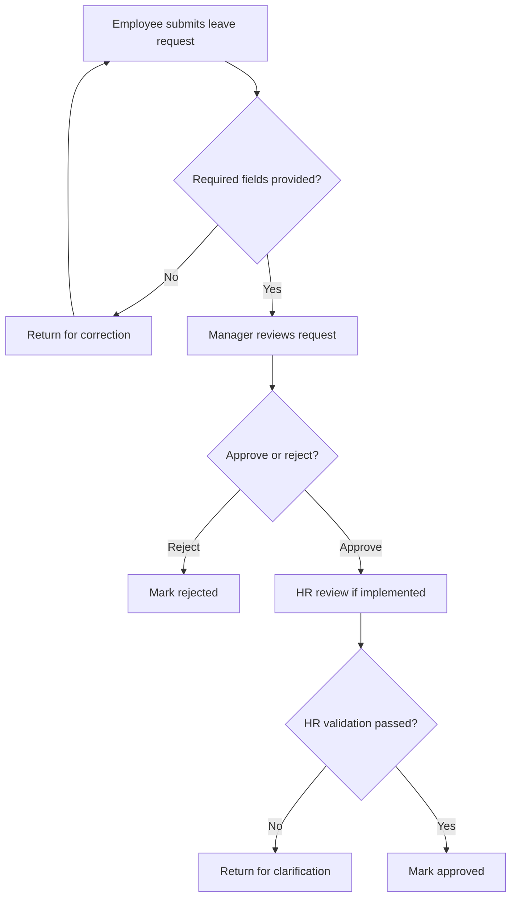

# Proposed HR leave request approval workflow

**Design only:** this diagram is not proof of a configured or tested process. Update it to reflect what actually works in the SAP trial.

If the trial does not support HR review or form validation, simplify the actual implementation to employee form, manager decision and conditional routing. Maintain a clear distinction between **planned** and **implemented** steps.
