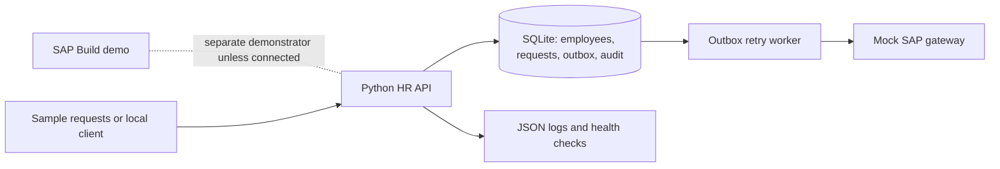

# Enterprise engineering roadmap

**Status:** Design and acceptance criteria only. None of the enhancements below should be presented as built or verified until implementation and tests exist.

## Goal and architecture

Demonstrate a fictional employee leave process with an **SAP Build Process Automation workflow** (ESS-style request, manager decision, optional HR review) and a **separate Python HR backend**. The backend communicates with a **mock SAP gateway**, not a real SAP HCM or SuccessFactors environment.

A dotted conceptual connection is not a real API integration. If we later connect SAP Build to Python, document actual authentication, API endpoints and execution tests.

## Priorities for the initial 5-hour session

| Priority | Area | Minimum demonstrable outcome | Acceptance test |
| --- | --- | --- | --- |
| P0 | Leave submission | Create synthetic employee leave request | Valid request saved; invalid dates rejected |
| P0 | Manager decision | Approve/reject workflow in SAP Build, if supported | Screenshots from real SAP run |
| P0 | Idempotency | A unique submission key prevents double creation | Same key submitted twice yields one request |
| P0 | Leave balance | Reserve requested leave using a SQLite write transaction | Two simultaneous 5-day requests against 6 available days cannot both succeed |
| P0 | Test evidence | Automated tests and actual results | Results recorded with commands and dates |
| P1 | Offline sync | Database outbox retries mock gateway failures with backoff | Gateway-down event stays pending and later syncs once |
| P1 | Circuit breaker | Trip after 5 consecutive mock gateway failures | Calls short-circuit during open state; queue persists |
| P1 | Delegation | Date-limited alternate approver | Only active proxy can approve during delegation window |
| P1 | Audit integrity | HMAC-SHA256 chained audit records | Altered event fails verification |
| P1 | Observability | JSON logs with correlation IDs; readiness probes | One ID traced through request and sync attempt |
| P2 | Privacy | Synthetic seeding, sanitization, no secrets in logs | Automated scan finds no raw PII in emitted logs |
| P2 | Integrations | Actual SAP Build to Python service connection | A real request traverses both systems, evidenced by tests |

If time is limited, finish P0 first. P1 and P2 remain planned until implemented and proven. Do not spend time on Redis, RabbitMQ or Kubernetes before the core is working.

## Backend design (proposed)

- Runtime: Python 3.11+.
- API: FastAPI (or a lightweight standard-library alternative), with typed input validation.
- Persistence: SQLite for local proof of concept; for a multi-instance production system use PostgreSQL or an equivalent production database.
- Key tables: `employees`, `leave_requests`, `approver_delegations`, `outbox_events`, `audit_events`, `mock_gateway_receipts`.
- Submission transaction: `BEGIN IMMEDIATE`, check idempotency key, verify remaining unreserved balance and date overlap, reserve days, insert request and outbox event, commit.
- Approval transaction: atomically change pending -> approved and move reserved days to consumed. Rejection releases reserved days. Never debit twice on a replay.
- Outbox: persist event before attempting the gateway. Use a stable event ID and a unique key on the mock gateway receipt table. Retrying the same event must not duplicate its effect.
- Retry strategy: bounded exponential backoff with jitter and a dead-letter state after configured attempts.
- Circuit breaker: after 5 consecutive timeout/connection failures, queue subsequent sync attempts rather than hammer the gateway; test recovery after a configured cooldown.
- Delegation: store manager, proxy, validity interval, revocation state and approve/reject permissions; validate active dates and prevent self-approval.
- Audit: canonical JSON event representation, previous digest chain and HMAC secret from environment variable. This is **tamper-evident only under key protection**; an attacker with the HMAC key and DB access could forge the history. For stronger assurances, periodically anchor signed digests outside the DB.
- Privacy: use synthetic names and IDs and redact identifying fields in logs and publicly shared screenshots.
- Health: expose separate liveness and dependency/readiness checks. Return per-dependency statuses including DB, outbox backlog and mock gateway. Don't claim Redis is connected if not installed.
- Logging: structured JSON with request/correlation ID, without secrets or HR-sensitive values. Carry the correlation ID to the outbox event and mock gateway.

## Test cases to add

| Case | Expected result |
| --- | --- |
| Duplicate POST with same idempotency key | Same logical request, no second reserve |
| Two concurrent 5-day requests, 6 days available | At most one succeeds; available balance never negative |
| Overlapping dates for same employee | Rejected or explicitly handled under documented policy |
| Manager absent but valid proxy exists | Request routed to active proxy |
| Expired or revoked proxy | Proxy approval forbidden |
| Gateway times out five consecutive times | Circuit breaker opens; events remain queued |
| Gateway recovers | Pending event replays with original ID, applied once |
| Audit row altered manually | Chain verifier detects mismatch |
| Missing audit HMAC key | Service refuses production mode or flags insecure dev mode |
| Sensitive fields in client request | Logs do not reveal private employee details |
| Database unavailable | Readiness reports degraded with useful body |
| Same correlation ID across API and retries | Logs enable end-to-end trace |

## Done means proven

A feature is **implemented** only with code/configuration committed to GitHub. A feature is **verified** only after reproducible tests or actual SAP screenshots are attached and the test record updated. Plans, Copilot suggestions, and sample diagrams are not proof of implementation.

## Useful Copilot tasks

1. Create unit tests for idempotency, balance locking and the outbox retry worker using only synthetic data.
2. Write a pure-Python HMAC audit-chain verifier and negative tampering test.
3. Review Python API logs for accidental PII exposure.
4. Review error handling for network failures, database locks and retries.
5. Identify any claims in README that are not substantiated by actual files or screenshots.
