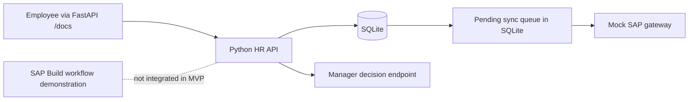

# Interview-friendly MVP build plan

**Decision:** Build a small-to-moderate, explainable HR leave approval demo. This is a scope plan, not proof of implemented functionality.

## Goal

Demonstrate an employee leave request, manager decision, leave balance controls, and a safe retry to a **mock SAP gateway**. Use synthetic employees only. Keep the separate SAP Build Process Automation trial workflow as an optional visual/process automation component. Do **not** claim real SAP HCM or SuccessFactors integration unless it is built and verified.

## Technology choices

- **Python 3.11+**: readable business logic.
- **FastAPI**: simple HTTP endpoints with interactive /docs.
- **SQLite** using Python's built-in `sqlite3`: store employees, requests and sync events; no database server installation required.
- **pytest**: automated tests demonstrating what works.
- **GitHub Copilot**: help write simple tests and documentation, followed by our manual review.
- **SAP Build Process Automation**: parallel SAP-side employee-to-manager workflow, if trial access supports configuration.

No Docker, Redis, RabbitMQ, Celery or PostgreSQL required for the MVP.

## Interview-ready architecture

## Features to finish, in order

| Order | Feature | Business explanation | Verification |
| --- | --- | --- | --- |
| 1 | Create leave request | Employee requests time off | API returns stored request |
| 2 | Approve/reject request | Manager reviews request | Status changes with the decision |
| 3 | Prevent duplicate requests | Retry of same request must not deduct twice | Same idempotency key produces one request |
| 4 | Protect leave balance | Two concurrent submissions cannot overspend the same leave balance | SQLite transaction test |
| 5 | Queue gateway sync | Temporary mock SAP failures should not lose approved requests | Failure stays pending; retry succeeds |
| 6 | Simple health + logs | HR support team can investigate failed requests | /health and correlation ID appear in logs |
| 7 | Evidence and documentation | Recruiter can examine actual results | Screenshots, tests, README and interview notes |

### If time remains, optional enhancements
- Delegated approval when manager is on leave (date-limited proxy).
- Circuit breaker after repeated mock SAP failures.
- HMAC-chained audit integrity checks.

**Avoid claiming:** real SAP integration, GDPR/SOC 2 compliance, payroll processing, cryptographically tamper-proof logs, or production-grade distributed reliability. These would require more design and evidence.

## Five-hour starter schedule

1. **0–30 min**: Check Python, VS Code and Git; clone project.
2. **30–100 min**: Create SQLite data model and FastAPI leave-request endpoint.
3. **100–160 min**: Manager decision plus duplicate submission safety.
4. **160–220 min**: Leave balance transaction and 3–4 pytest cases.
5. **220–270 min**: Mock SAP outage and manual retry queue.
6. **270–300 min**: Run tests, capture evidence and update GitHub.

If SAP Build trial setup succeeds quickly, do an employee/manager approval form separately; do not sacrifice a working, tested backend to the trial's access restrictions.

## Questions to be able to answer in an interview

1. What business problem does the workflow solve?
2. What does FastAPI do, and why did you choose Python?
3. What data is stored in SQLite?
4. What happens when someone clicks submit twice?
5. How do you avoid deducting more leave than an employee has?
6. What happens when the mock SAP system is unavailable?
7. What did you actually test, and what were the results?
8. What would you change before using real employee data or connecting to live SAP?

## Implementation status

All application and test features listed above are **planned / not yet verified** as of this document's creation. Update this status only when the code is committed and corresponding tests pass.
